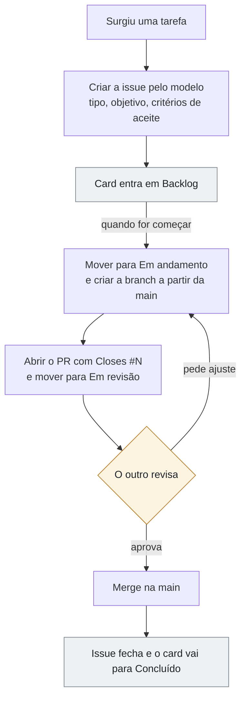
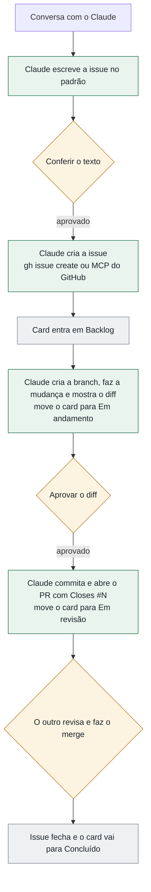

# GitHub Projects — Madiba Order Manager

> **Guia de processo.** Como as tarefas deste repositório são organizadas: um quadro do
> **GitHub Projects** ligado ao repo, no lugar do Trello. Substitui o antigo `trello-padrao.md`.
> O **processo** (papel, "Grill Me", PT-BR) é dono do [`como-trabalhamos.md`](como-trabalhamos.md),
> e branches e deploy são donos do [`branches-e-deploy.md`](branches-e-deploy.md). Este guia não
> duplica essas regras.

## Por que Projects e não Trello

- **O card é a issue.** Um PR com `Closes #N` fecha a issue no merge, e o card vai sozinho para
  "Concluído". No Trello, ligar card e PR era manual.
- **Tudo num lugar só:** código, ADRs, issues, PRs e o quadro.
- **Automações prontas e grátis**, no próprio projeto.
- **Quem usa são só os devs.** Perguntas de negócio para a loja ficam num doc versionado, não no
  quadro.
- **O que se perde, e foi aceito:** o checklist do card estilo Trello e os power-ups. Os critérios
  de aceite viram lista de tarefas na issue (`- [ ] item`), ou sub-issues quando a tarefa é grande.

## Configuração do quadro

O projeto pertence à conta do Giovanni, é **privado** e fica ligado ao repo (aba **Projects** do
repo → **Link a project**).

| Item | Configuração |
|---|---|
| Modelo | **Board** |
| Colunas (campo **Status**) | Backlog · Pronto para fazer · Em andamento · Em revisão (PR aberto) · Concluído |
| Campo **Tipo** (seleção única) | SPEC · ADR · GUIA · FEAT · FIX · SEC · CHORE (ver [Tipos](#tipos-de-tarefa)) |
| Campo **Fase** (seleção única) | 0 Decisões · 1 Mockup · 2 Acesso · 3 Pedido · 4 Capacidade · 5 Polimento ([`escopo-v1.md`](escopo-v1.md#fases)) |
| Automações (menu **Workflows**) | **Item closed** e **Pull request merged** → Concluído · **Item added to project** → Backlog · **Auto-add to project** com filtro `is:issue is:open` (só issues: o card é a issue, e o PR aparece dentro dela pelo `Closes #N`; o plano Free permite 1 regra de auto-add por projeto) |
| Visões | **Board** agrupado por Status · **Table** agrupada por Fase |

## Fluxo de uma tarefa

Os passos em cinza o GitHub faz sozinho.



## Fluxo de uma tarefa com o Claude

O Claude escreve e executa; as decisões continuam com a gente. Nada é commitado sem o diff
aprovado ([`como-trabalhamos.md`](como-trabalhamos.md)).



Para o Claude mexer no quadro (adicionar item, mudar Status e Fase), o `gh` de quem estiver usando
precisa da permissão `project`: `gh auth refresh -s project`. Os comandos são
`gh project item-add` e `gh project item-edit`. O servidor MCP oficial do GitHub também tem
ferramentas de Projects, desligadas por padrão.

## Padrão de issue

Toda issue nasce do modelo [`.github/ISSUE_TEMPLATE/tarefa.yml`](../.github/ISSUE_TEMPLATE/tarefa.yml).

### Título

```
<emoji> <TIPO>: <descrição curta>
```

### Tipos de tarefa

| Tipo | Quando usar |
|---|---|
| 📄 **SPEC** | Especificar regra/comportamento que **já existe** no código. |
| 📐 **ADR** | Decisão de arquitetura **com trade-off** → vira ADR numerado em `adr/` (modelo em [`adr/0000-template.md`](adr/0000-template.md)). |
| 📘 **GUIA** | Convenção de processo/governança, **sem trade-off** de arquitetura. |
| 🔧 **FEAT** | Código novo / nova funcionalidade. |
| 🐛 **FIX** | Correção de bug. |
| 🔐 **SEC** | Segurança / credenciais. |
| 🧹 **CHORE** | Higiene técnica (deps, tipos, limpeza). |

**SPEC × ADR × GUIA:** SPEC descreve o que o código faz; ADR decide um caminho entre
alternativas (tem trade-off); GUIA fixa uma convenção de processo (sem trade-off de
arquitetura; se tivesse, seria ADR).

### Corpo

1. **Objetivo:** o porquê, em 1–3 linhas.
2. **Contexto / Onde mora hoje:** arquivos e linhas reais.
3. **Pauta / Opções:** só quando há decisão a tomar (alternativas + trade-offs).
4. **Premissa a verificar:** só quando há suposição a medir antes de decidir.
5. **Entregável:** o artefato concreto; doc novo entra no índice [`README.md`](README.md).
6. **Critérios de aceite:** lista de tarefas verificáveis.
   - O **primeiro** item sempre começa por **`GRELHAR primeiro: …`**.
   - O **último** item sempre é **`Entregue via branch → PR para main (sem deploy a produção sem permissão)`**.
